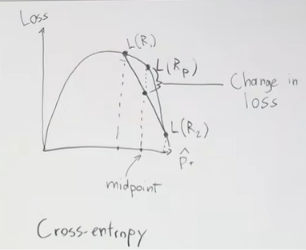
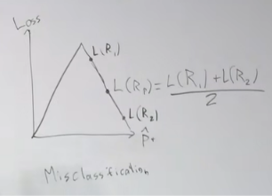
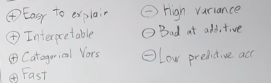
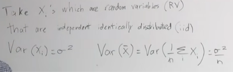
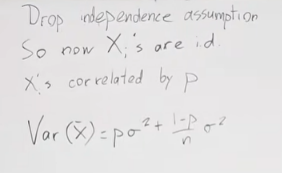

# Decision Trees and Ensemble Methods

## 1. Decision trees

A decision tree is a nonlinear model that divides the feature space into regions using a sequence of questions about individual features. Each internal node applies a split, each branch represents an outcome of that split, and each leaf gives a prediction.

Tree construction uses **top-down, greedy, recursive partitioning**:

- **Top-down:** begin with the full input space.
- **Recursive:** split a region, then treat each child region as a smaller problem.
- **Greedy:** at each step, choose the split that gives the best immediate improvement. The procedure does not search through every possible complete tree.

A numerical split is usually defined by a feature (j) and threshold (t). Within a parent region (R_p), it creates child regions such as:

$$
R_1 = \{x \in R_p \mid x_j < t\}, \qquad
R_2 = \{x \in R_p \mid x_j \ge t\}.
$$

The purpose of a split is to create child regions in which predictions are more reliable than a prediction made over the whole parent region.

## 2. Classification leaves and split criteria

For classification, a leaf predicts the most common class among the training observations that reach it. Let $$hat p_c$$be the proportion of observations in a region that belong to class (c).

### Misclassification loss

The misclassification loss of a region is the fraction that would be classified incorrectly if the region predicted its majority class:

$$
L_{\text{misclass}}(R) = 1 - \max_c \hat p_c.
$$

A candidate split is assessed by comparing the parent loss with the **observation-weighted** losses of its children:

$$
\text{gain} = L(R_p) - \left(w_1 L(R_1) + w_2 L(R_2)\right),
$$

where (w_i) is the proportion of the parent observations that go to child (i). A useful split has a large positive gain.

Misclassification loss is not very sensitive to changes in class proportions as long as the majority class stays the same. Two splits can therefore have the same misclassification loss even if one creates more informative class distributions. This makes misclassification loss less useful for choosing splits during tree growth.

### Entropy / cross-entropy

Entropy is a more sensitive measure of class mixture:

$$
L_{\text{entropy}}(R) = -\sum_c \hat p_c \log_2(\hat p_c).
$$

Entropy is zero when a region contains only one class. It is larger when the class proportions are more evenly mixed. The information-theoretic interpretation is that a mixed region requires more information to identify an observation’s class.

We have used base 2 to express information in bits. Using another logarithm base only multiplies entropy by a positive constant, so it does not change which split is best.

Because the parent class proportions are the weighted average of the children’s proportions, the parent entropy can be compared with the weighted average child entropy. The reduction is the **information gain** of the split.

A split takes one parent region (R_p) and divides it into child regions (R_1) and (R_2). Each region has its own class proportions and therefore its own impurity (loss).

The parent’s class proportions are the **weighted average** of the children’s proportions. The children’s combined loss is also a weighted average:

$$
L_{\text{children}} = w_1 L(R_1) + w_2 L(R_2),
\qquad w_1 + w_2 = 1,
$$

where (w_i) is the fraction of the parent’s observations that went to child (i). If the children are the same size, each weight is (1/2), so this is just the midpoint between their losses.

For classification, entropy is

$$
H(p) = -\sum_c p_c \log(p_c),
$$

where (p_c) is the proportion of class (c) in the region. For two classes, we can plot entropy against the proportion of one class. The curve is strictly concave: it is low for nearly pure regions and high for a more even class mixture.

Suppose a split produces children with different class proportions. On the plot, their proportions sit at different positions on the curve. The parent proportion is the weighted average of those positions. Because the curve is strictly concave, the parent’s entropy is greater than the weighted average of the children’s entropies, provided the children’s class proportions differ:

$$
H(R_p) > w_1 H(R_1) + w_2 H(R_2).
$$

The gap is the change in loss, or the **information gain** from the split:

$$
\text{Information Gain}
= H(R_p) - \left[w_1 H(R_1) + w_2 H(R_2)\right].
$$

For an uneven split, the combined child loss is not the midpoint; it is the weighted point along the line connecting the child losses. Concavity still puts that weighted average below the parent entropy when the children have different class proportions.

If both children have the same class proportions as the parent, the split has no information gain.

### Why not misclassification loss

Misclassification loss only depends on which class is the majority:

$$
L_{\text{misclass}}(R) = 1 - \max_c p_c.
$$

Its curve is piecewise linear. If the parent and both children are on the same linear section, the weighted average child loss can equal the parent loss. The children may still have different class proportions, but misclassification loss does not register that change. So it can be too insensitive for selecting splits while a tree is growing.

BASICALLY NO GAIN IN INFORMATION.

### Gini impurity

Gini impurity is another common split criterion:

$$
L_{\text{Gini}}(R) = \sum_c \hat p_c(1-\hat p_c)
= 1 - \sum_c \hat p_c^2.
$$

Like entropy, Gini is low for nearly pure regions and higher for mixed regions. Both criteria are generally more informative for split selection than misclassification loss.

## 3. Regression trees and categorical features

### Regression trees

A regression tree predicts a numerical target. Each leaf predicts the mean target value (instead of just predicting the majority class) among its training observations:

$$
\hat y_m = \frac{1}{|R_m|}\sum_{i\in R_m} y_i.
$$
$$
|R_m|: how many points we have in R_m
$$

Splits are chosen to reduce within-region prediction error, commonly the sum of squared deviations from the leaf mean:

$$
\sum_{i\in R_m}(y_i - \hat y_m)^2.
$$

### Categorical features

A categorical feature can be split by testing whether its value belongs to a selected subset of categories. With (q) categories, exhaustively considering subsets can require examining exponentially many possibilities, on the order of (2^q). This becomes expensive for features with many categories. Some special cases allow more efficient searches; for binary classification, categories can be ordered by their positive-class proportions and candidate splits searched along that ordering.

## 4. Tree complexity and regularization

An unrestricted tree can continue splitting until it memorizes the training data. This can produce low training error but poor generalization. Trees are therefore often **high variance**: their fitted structure can change substantially when the training sample changes.

Common controls on tree growth include:

- **Minimum leaf size:** stop splitting a region when it has too few observations.
- **Maximum depth:** limit the number of splits along any path.
- **Maximum number of nodes or leaves:** limit the total size of the tree.

- **Minimum decrease in loss:** If a split does not reduce the loss by a certain amount, the tree should stop growing at that point. 

A strict minimum-improvement rule can stop a tree too early. Some patterns require multiple splits: an initial split may provide little immediate benefit, while a later split within one child may be valuable. 

- **Pruning:** grow a tree and then remove branches that do not improve performance on held-out data.

Pruning after growing the tree can preserve the opportunity to find such multi-step structure. 

Use validation performance to guide pruning. MISCLASSIFICATION WITH VAL SET.

## 5. Computation and properties of a single tree ???????????????????

Let (n) be the number of observations, (f) the number of features, and (d) the tree depth.

- Prediction follows one path from root to leaf and takes roughly (O(d)) operations. d<log n

- A rough training-time estimate from the lecture is (O(nfd)), assuming efficient searches over feature split candidates.
        Each point is part of (O(d)) nodes
        Cost of point at each node is (O(f))
        We have n points total.
        Data matrix is of size nf
        so training time is also somewhat fast

- A balanced binary tree often has depth on the order of \(\log n\), while an unbalanced tree can be deeper.

**Strengths:** trees can model nonlinear decision boundaries and feature interactions, can handle categorical features, are relatively fast, and can be interpreted by following their sequence of splits.

(variance measures how much a model's predictions fluctuate when it is trained on different subsets or versions of the training data. A high-variance model is overly sensitive to the specific noise or details in its training set, which often leads to overfitting, meaning it performs well on training data but fails to generalize to new, unseen data.)

**Limitations:** trees can overfit and have high variance. Their splits are axis-aligned, so they can need many regions to approximate boundaries that do not align with individual feature axes. A single tree may consequently have limited predictive accuracy.

## 6. Why ensembles help

An ensemble combines predictions from multiple models. Averaging can reduce variance when the models do not make exactly the same errors.

For (M) models with equal variance \(\sigma^2\) and pairwise correlation \(\rho\), the variance of their average is:

$$
\operatorname{Var}(\bar X) = \rho\sigma^2 + \frac{1-\rho}{M}\sigma^2.
$$

This simplified expression highlights two ways to reduce ensemble variance:

1. Increase the number (M) of models, reducing the second term.
2. Reduce correlation \(\rho\) among the models, reducing the first term.

If models are independent, averaging reduces variance to \(\sigma^2/M\). If they are perfectly correlated, averaging does not reduce variance. Model diversity is therefore important.

Ensembles can create diversity by using different learning algorithms, different training samples, or procedures such as bagging and boosting that vary how component models are fit.

